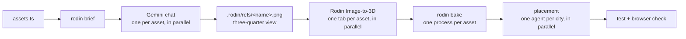

# Rodin pipeline: batch flow

Organic forms the kit primitives cannot express (statues, animals, boats,
terrain) are reconstructed with Hyper3D Rodin **Image-to-3D** from one
reference image per asset made in the Gemini chat, then baked into source as
quantised, untextured meshes. Nothing is downloaded at runtime: each colour
area of a model becomes one palette material.

The whole batch moves together. Every asset is listed in
`scripts/rodin/assets.ts`, and `bun run rodin status` always says what each one
needs next. No API keys: Gemini and Rodin are used through their web UIs.



| State | Meaning | Next |
|---|---|---|
| `need refs` | No `.rodin/refs/<name>.<png\|jpg\|jpeg\|webp>` | Gemini, prompt in `.rodin/BRIEF.md` |
| `need glb` | Image saved, no `.rodin/<name>.glb` | Rodin, upload list in `.rodin/BRIEF.md` |
| `ready` | GLB present, never baked | `bun run rodin bake` |
| `stale` | GLB, `tris`, `colours` count or `clean` changed since the last bake | `bun run rodin bake` |
| `baked` | Up to date, not yet used by every city in `cities` | Place it |
| `placed` | Every listed city imports it | Done |

## 1. Brief

```sh
bun run rodin brief          # every asset that needs an image or a GLB; or name some
```

Writes `.rodin/BRIEF.md`, regenerated from the manifest and the files on disk
each time, so rerun it whenever images arrive. The file is replaced, not
appended to: naming assets leaves only those in it, so run plain `brief` to
see the whole open batch.

- **Gemini section**, per asset without an image: one prompt for a
  **three-quarter** view (the angle that shows the most of any object; Rodin
  needs nothing else). Assets with a `poster` crop get
  `.rodin/refs/<name>.poster.png` to attach to the prompt.
- **Rodin section**, per asset with an image: which file to upload and the GLB
  name to save.

The prompts come from the manifest: `look` (shape and proportions), `colours`
(the exact flat colour areas, each matched to the city palette), `exclude`,
plus shared rules for Image-to-3D input: square image, whole object centred
with margin, plain white background (asking Gemini for transparency makes it paint a fake checkerboard), no ground or shadow, even light, matte
flat colours, a clean miniature-model style.

## 2. Reference images in Gemini (you)

One chat per asset; run several at once. Save each result as
`.rodin/refs/<name>.<png|jpg|webp>`. Regenerate rather than saving when the
image fails the checklist at the top of the brief: cropped, ground or shadow,
extra colours, outlines or a photo look. Gemini cannot draw real transparency;
a plain white background is fine (Rodin removes it), a painted checkerboard is
not. Paint out Gemini's sparkle watermark in the bottom-right corner with the
background colour before uploading, or Rodin models it as a stray blob.

## 3. Image-to-3D in Rodin (you)

One tab per asset, all at once: **Image to 3D**, upload the image, no prompt,
**Gen-2.5** with effort **High** (0.5 credits each on the Creator plan) and
presets **Use Recommended**. Leave Agentic Mode off. Rodin works in two stages:

1. **Geometry:** check the preview (one object, no ground disc), then
   **Confirm**.
2. **Material:** **Generate**, then **Confirm** again. Skipping this confirm
   leaves the model untextured, and the bake has no colours to sample.

Then choose **GLB** (not FBX; the bake reads GLB only) and Download. The
download is a zip holding `base_basic_pbr.glb` (textured) and
`base_basic_shaded.glb`. Extract the **pbr** one as `.rodin/<name>.glb`.
`status` lists GLBs whose names are not in the manifest, so a download saved
under Rodin's own name shows up.

## 4. Bake

```sh
bun run rodin bake            # every ready or stale asset, one process per asset
bun run rodin bake sphinx     # or just the named ones
```

Each bake samples the texture colours, splits the faces into one region per
`colours` entry and absorbs speckles. It then simplifies each region to its
share of `tris` with region borders locked, which keeps thin colour features
such as headdress stripes exact. If the locked borders leave the total more
than 15% over `tris` (ragged borders on dense 500k-triangle Rodin meshes), it
instead simplifies the whole mesh at once and colours each triangle by the
nearest original one: on budget, with blockier region outlines. Either way
regions share vertices, so there are no cracks. It writes
`src/cities/shapes/<name>.shape.ts`. The header lists each part's sampled
colour, darkest first, and stamps the GLB hash and options; that stamp is how
`status` detects stale files. Commit the `.shape.ts`, never the GLB or images,
and regenerate rather than editing it.

## 5. Place, in parallel (one agent per city)

City files are independent, so placement fans out by city: one agent per city
with `baked` assets, each owning only `src/cities/list/<slug>.ts`. An asset
shared by several cities (`camel`) is placed by each of them. Per asset:

```ts
import SPHINX from '../shapes/sphinx.shape';

root.add(shape(SPHINX, [NEMES_DARK, NEMES, STONE], { x: -4.3, z: 0.3, ry: 0, height: 1.6 }));
```

- Materials follow the part order in the file header (darkest first); use the
  city materials the manifest's `colours` were matched to.
- Match the footprint and height of the builder it replaces (`replaces` in the
  manifest), then delete that builder. A baked model rarely has the old
  builder's proportions: check what it now covers (Rio's Sugarloaf first buried
  the bay, four boats and the cable car) and move or resize neighbours.
- Facing: Rodin's front is not guaranteed to be +z. Find it from the vertices
  (a throwaway script that builds the shape and compares height or width at
  each end of the long axis, e.g. the head or bow end), then set `ry`.
  `Animator.follow` moves along +z, so an animated prop's front must be +z
  after `ry`.
- Per-instance tint (one model, several colours, like Hanoi's `BIKE_COLORS`)
  only reads if the tinted part is a large area. Give that area its own
  `colours` entry in the manifest and re-bake; a 60-triangle part is a speck
  on screen.
- Animated props (boats, bikes): build the group, `mergeStatic(group)`, then
  hand it to `Animator`, as `car()` does. Each animated instance costs one
  draw call per material, so many movers with many parts add up fast.
- `smooth: true` for smooth normals; faceted is the default and suits the kit.

Then `bun run test` (budgets) and a look at `#/<slug>` in `bun run dev`, both
at the default framing (is it visible, or hidden behind a tower?) and zoomed
in (facing, clipping into terrain or water). A reject goes back to step 2 with
a sharper `look` or `exclude`.

## Adding an asset

Add an entry to `scripts/rodin/assets.ts`: `name`, `cities`, `replaces`,
`subject`, `look`, `colours` (one entry per material, hex from the city
palette), `tris`, optionally `exclude` and `poster: { name, crop }` (pixel rect
in `assets/<name>.jpeg`; only when the poster shows the subject large and
unobstructed, roughly 120 px or more across). Keep lattices, bridges, cables
and towers procedural: Rodin renders thin structure as noise.

Budget guide: a hero sculpture 2–4k triangles, a repeated prop (camel, boat)
300–800. Each colour area costs one draw call per distinct material.

A city that places many copies of an existing asset can bake its own lighter
variant from the same GLB: spread the original entry, then set a new `name`,
its `cities`, `from: '<original name>'` and a lower `tris`. The bake reads
`.rodin/<from>.glb` and writes `src/cities/shapes/<name>.shape.ts`; no new
image or Rodin run. `motorbike-lite` (700 triangles, for the Ho Chi Minh City
swarms) is `motorbike` (1,500, Hanoi) baked this way.
